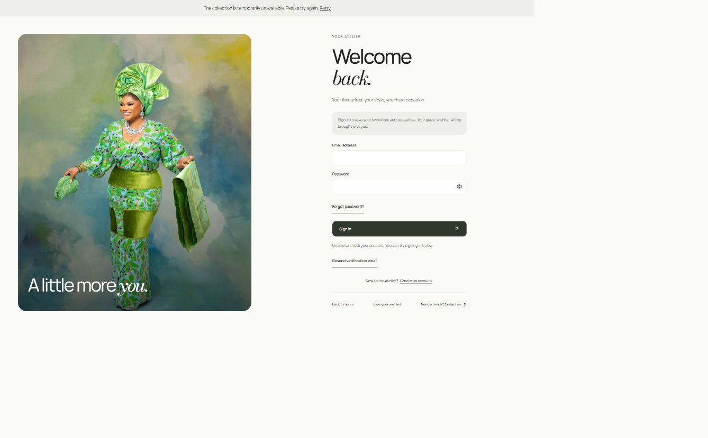

# Wearables account and API audit — 20 October 2026

**Later implementation:** [account dashboard and API integration](account-dashboard-integration-2026-10-20.md). Checkout HTTP and frontend integration were also merged upstream after this audit. Findings below describe the earlier inspected commits; use the implementation record for current code and deployment status.

Wearables does **not** yet match the supplied signed-in account dashboard reference. This was confirmed in Chrome using an existing signed-in session on the legacy storefront, as well as by reviewing the latest storefront and backend source. The custom storefront domain additionally has a confirmed API-origin failure.

## What was checked

- Live custom domain: `https://wearablesbyashabi.store/account`.
- Live legacy domain: `https://storefront.wearables.trustcodesystem.tech/account`.
- Latest storefront main: [`51a8905`](https://github.com/Trust-Code-System/wearables-atelier-storefront/commit/51a8905264a41deac94396b2a4bb2935fa03d18b).
- Latest backend main: [`e0839f5`](https://github.com/Trust-Code-System/wearables-backend/commit/e0839f5f5d9acede52bcd7877d223a951aac0de1).
- Admin main: `25f2f21`; local admin catalog/auth integrations and remaining browser demo state.
- Twelve anonymous GET probes and four CORS preflights against the configured staging API. Results: [account-api-probes-2026-10-20.json](account-api-probes-2026-10-20.json).

The backend README explicitly has stale sections, recorded in its `docs/known-issues.md`. Implemented controllers, current auth configuration and feature-specific documents were used to determine availability.

## Reference versus actual account

| Before / current Wearables | After / required reference behavior | Why / API status |
| --- | --- | --- |
| The authenticated page retains the large “Welcome back” auth composition, followed by the user name, wishlist link and Sign out. | A customer dashboard with the person's name/email, a brand image, overview and account navigation. | Confirmed in the existing signed-in browser session; the screenshot concern is valid after authentication too. |
| No orders tab or customer order-history frontend. | Orders list, empty/error/loading states and protected details. | Backend GET `/api/v1/store/orders` and `/:id` exist. History is scoped to the current account. Guest email matching must never assign ownership. |
| No saved-address management frontend. | Addresses with add/edit/delete/default controls. | Backend GET/PATCH `/api/v1/store/customers/me`, address CRUD and default endpoint exist. Profile PATCH edits phone only. Saved writes require verified email; maximum five Nigerian addresses. |
| No saved-measurements feature. | Measurements tab with defined units, fields and persistence. | No corresponding controller or application model was found in the inspected backend. This needs a backend contract before claiming saved measurements. |
| No customer avatar-upload flow. | Avatar picker with validated upload, save and removal. | Existing signed media upload API is admin-only. Do not reuse it as customer upload permission. A customer upload/attachment contract is still needed; a Better Auth user image field alone does not supply that flow. |
| No password-management dashboard panel. | Password settings and recovery links with clear success/error states. | Latest main has working transport and pages for Better Auth recovery/reset/verification, but no in-account change-password panel. Confirm the installed Better Auth change-password contract before building that panel. Live email delivery was not tested. |
| No email-settings panel. | Display current email and verification status; add email change only when supported. | Backend `user.changeEmail.enabled` is explicitly false. Never present a successful email-change action. |
| Login/signup are previews in this local working tree. | Keep the new visual design and use the latest real auth integration. | Remote main already includes email login/signup, logout, recovery, verification, account wishlist and server cart integration. Integrating the newer code must preserve those features. |

The latest source routes `/account` through `AccountForm mode="login"`. After sign-in, that form renders only the signed-in greeting/wishlist/logout block and normally redirects successful login to `/wishlist`. It has none of the reference dashboard tabs. Source: [latest AccountForm](https://github.com/Trust-Code-System/wearables-atelier-storefront/blob/51a8905264a41deac94396b2a4bb2935fa03d18b/src/components/account/account-form.tsx).

## Confirmed deployment blocker: origin and cookie cutover

The API is healthy and returns public catalog data to a non-browser client. This does not establish that the storefront can read it.

| Request | Observed result |
| --- | --- |
| Catalog/session/cart GET with Origin `https://wearablesbyashabi.store` | HTTP 200, but no `Access-Control-Allow-Origin` or credentials header. Browser JavaScript cannot read the response. |
| Auth POST preflight from `https://wearablesbyashabi.store` | HTTP 404, no allowed-origin header. |
| Same preflight from `https://admin.wearablesbyashabi.store` | HTTP 404, no allowed-origin header. |
| Same preflight from legacy storefront | HTTP 204, exact allowed origin and `Access-Control-Allow-Credentials: true`. |
| Same preflight from `http://localhost:3100` | HTTP 404, no allowed-origin header. |
| Protected customer/profile/address/order/wishlist and admin order/shipping GET without cookies | HTTP 401. Anonymous rejection is expected; it is not evidence that the route is absent. |

The custom-domain UI visibly displays “The collection is temporarily unavailable” and “Unable to check your account”. The legacy page resolves the existing authenticated session. No new sign-in, password entry, account creation or sign-out was performed in this audit.

There is also a **backend configuration validation gap** in the previous cutover plan: production validation currently requires every auth/frontend hostname to satisfy `hostname.endsWith('.' + COOKIE_DOMAIN)`. With `COOKIE_DOMAIN=wearablesbyashabi.store`, the actual storefront apex `wearablesbyashabi.store` fails that predicate. Adding the custom origin to environment variables without fixing this would fail production startup. The approved parent itself and its subdomains need to be accepted while unrelated and suffix-lookalike domains remain rejected. Source: [environment validation](https://github.com/Trust-Code-System/wearables-backend/blob/e0839f5f5d9acede52bcd7877d223a951aac0de1/src/config/env.ts).

Complete the existing [domain cutover](domain-cutover.md) with an HTTPS API under the Wearables parent, matching cookie parent, exact trusted origins and rebuilt frontend API settings. Keep HttpOnly/Secure cookies, origin checks and credentialed requests. Adding CORS alone does not move cookies from the unrelated TrustCode domain or resolve SameSite restrictions.

## Other API gaps

| Area | Backend / latest remote frontend | Remaining integration |
| --- | --- | --- |
| Catalog | Public products; admin catalog, media and stock APIs. Already integrated. | Repair custom-domain API access. |
| Bag | Guest/account persisted cart, stock issues and explicit merge after login. Latest storefront main has transport/provider integration. | Reconcile the newer integration with local UI changes; preserve ownership and do not restore the old browser-only bag. |
| Wishlist | Session-owned wishlist with guest import, retry receipts and stale-account protection. Latest main integrates it. | Preserve the full synchronization state machine when applying the auth redesign. |
| Shipping | Live states/LGAs/destinations/options/settings/quote APIs and owner-only configuration. | Frontend still has prototype standard/express/free-threshold logic. Replace it with explicit server rate selection; no guessed same-day or free-shipping claims. |
| Checkout | Internal transactional order/reservation/payment preparation coordinator. | No public checkout controller exists at inspected backend main. Strict HTTP authorization/DTOs, pickup-specific input, return grant and provider redirect are still required. |
| Payment | Internal Paystack initialization and public webhook/settlement infrastructure exist. | No public initialization endpoint for the current storefront checkout. A successful simulated slider is not payment evidence. No charge/provider test was performed. |
| Customer order recovery | Proof request/redeem, device grants and status reads are implemented. | Guest recovery/return frontend and configured landing URL need integration. No email or guest-order linking was attempted. |
| Admin orders | Owner-only list/detail/fulfilment endpoints exist. | Current admin order/analytics/customer demo state does not become real backend data automatically. The seeded admin role is not equivalent to the verified owner role. |

Primary backend contracts: [customer controller](https://github.com/Trust-Code-System/wearables-backend/blob/e0839f5f5d9acede52bcd7877d223a951aac0de1/src/modules/customers/customers.controller.ts), [auth options](https://github.com/Trust-Code-System/wearables-backend/blob/e0839f5f5d9acede52bcd7877d223a951aac0de1/src/modules/auth/auth.options.ts), [order access](https://github.com/Trust-Code-System/wearables-backend/blob/e0839f5f5d9acede52bcd7877d223a951aac0de1/docs/order-access.md), [shipping](https://github.com/Trust-Code-System/wearables-backend/blob/e0839f5f5d9acede52bcd7877d223a951aac0de1/docs/shipping.md), [checkout](https://github.com/Trust-Code-System/wearables-backend/blob/e0839f5f5d9acede52bcd7877d223a951aac0de1/docs/checkout.md), [payments](https://github.com/Trust-Code-System/wearables-backend/blob/e0839f5f5d9acede52bcd7877d223a951aac0de1/docs/payments.md).

## Shipping policy now exposed by the live API

Settings version 1 confirms ten preparation working days Monday–Friday for all products, domestic transit estimates of one to three working days Monday–Saturday, and dispatch Monday–Saturday 09:00–14:00 Africa/Lagos. Pickup is enabled/free under the documented contract, 10:00–18:00, code required; pickup weekdays are null, meaning confirm the collection day with the store. Pickup address: D4 Alhaji Masha Road, Shitta Roundabout. Public phone: +2348052310486.

The shipping contract prices explicit destinations per order, rather than one fee for all Lagos. Unsupported destinations require a store quote before delivery payment. The reviewed API supports Nigerian destinations; no international carrier/pricing API was found. Pickup quoting exists, but address-free pickup checkout is explicitly unfinished. Staff/courier automation is not supplied by these quote endpoints.

## Integration order and scope of this audit

1. Reconcile latest storefront main with the existing uncommitted design/QA work. The local HEAD is `0585565`, seven commits behind fetched main. No pull, reset, stash or merge was performed, and existing edits remain intact.
2. Fix and verify backend apex-domain validation, then complete API DNS/HTTPS, origin/cookie and frontend build configuration cutover.
3. Build the authenticated `/account` dashboard, preserving the new auth screens as `/account/login` and `/account/register`. Wire overview, phone, addresses and orders to session-owned APIs; use actual empty/error/retry states, accessible themed tabs and responsive layouts.
4. Define measurement persistence and customer avatar upload before enabling their save actions. Keep email change unavailable until supported.
5. Replace prototype shipping and expose the public checkout integration before enabling payment claims. Connect owner order UI using the required role.

This task produced an audit, request evidence and a correction to deployment guidance. It did not implement the dashboard, merge newer remote application code, change hosted configuration, publish a deployment, submit customer data, send email or take payment. Backend test files were inspected as evidence of intended invariants; the backend suite and frontend build were not rerun for this read-only audit. Anonymous HTTP results do not prove authenticated CRUD, email delivery, payment settlement or end-to-end commerce.

